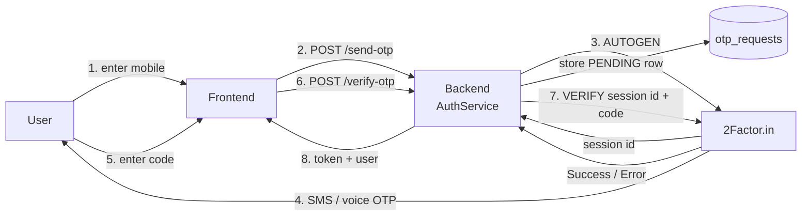
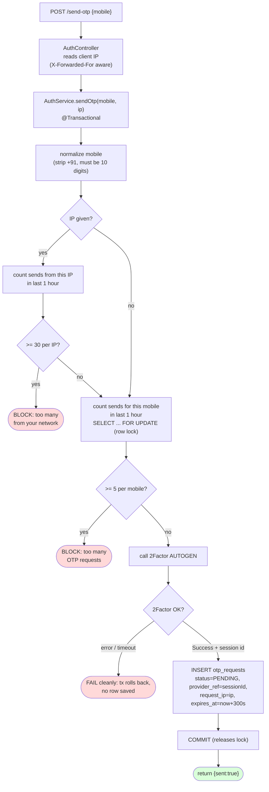
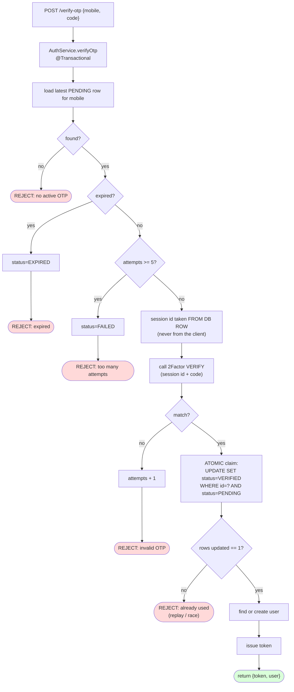
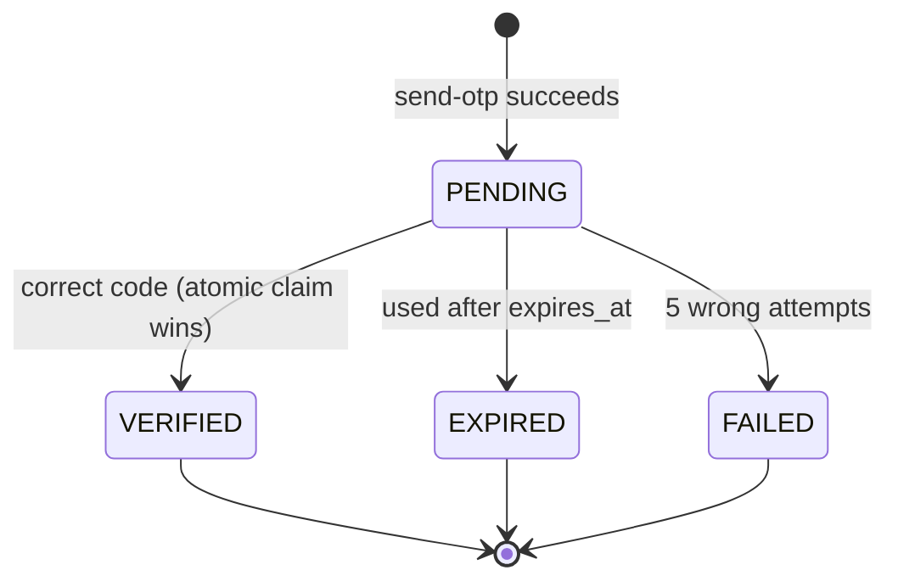

# KisanFarm — Agricultural E-commerce Marketplace

**Grow • Protect • Harvest**

A single Spring Boot application that serves both the REST API and the React UI
on **one port (8080)**. Buyers browse products, log in with a mobile OTP, add to
cart and check out. Admins/sellers log in with a username and password to manage
products, stock and festival offers.

```
                    KisanFarm
                        │
         ┌──────────────┴──────────────┐
         │                             │
     frontend                     Spring Boot
   React + Vite                      API
         │                             │
         │      HTTP / REST (/api)     │
         └────────────────────────────►│
                                       │
                                 ┌─────┴─────┐
                                 │           │
                              MySQL     External APIs
                                            │
                                 ┌──────────┼──────────┐
                                 │          │          │
            2Factor.in     Payment    Shipping
                               (OTP)     (Stripe)    (future)
```

---

## 1. Tech stack

| Layer | Technology |
|---|---|
| Backend | Java 21, Spring Boot 3.3.5, Maven |
| Data access | **Spring JDBC Template** (no JPA/Hibernate) |
| Database | MySQL 8 (`kisanfarm`) |
| Frontend | React 18, Vite 5, React Router 6, Axios |
| OTP | 2Factor.in (SMS/voice OTP; API-key driven) |
| Payments | Stripe (pluggable; mock provider for dev) |
| Serving | React production build is served by Spring Boot — one port, one process |

---

## 2. Project structure

```
KisanForm/
├── pom.xml                         Maven build (Java 21, Spring Boot 3.3.5)
├── README.md                       This document

├── verify-flows.ps1                End-to-end smoke test for both flows
│
├── src/main/java/com/kisanfarm/
│   ├── KisanFarmApplication.java   Entry point
│   ├── model/                      Plain POJOs (no JPA annotations)
│   │   ├── Product.java            getEffectivePrice(), isInStock()
│   │   ├── User.java               Buyer (mobile-based)
│   │   ├── AdminUser.java          Admin (username + password hash)
│   │   ├── OtpRequest.java         OTP audit record (hash only, never raw)
│   │   ├── Order.java  OrderItem.java  Payment.java
│   ├── dao/                        DAO interfaces
│   ├── daoimp/                     JDBC Template implementations
│   ├── service/                    Business logic + provider abstractions
│   │   ├── AuthService.java        OTP send/verify, rate limits, user creation
│   │   ├── AdminAuthService.java   Admin username/password login
│   │   ├── AdminTokenGuard.java    Validates X-Admin-Token
│   │   ├── OrderService.java       Checkout; recomputes all prices server-side
│   │   ├── OtpProvider.java        + TwoFactorOtpProvider (2Factor.in)
│   │   └── PaymentProvider.java    + MockPaymentProvider, StripePaymentProvider
│   ├── controller/                 REST endpoints
│   └── config/
│       ├── SpaForwardingConfig.java  Forwards SPA routes to index.html
│       └── TwoFactorConfig.java      RestClient (timeouts) for 2Factor OTP
│
├── src/main/resources/
│   ├── application.properties      Config (all secrets via env vars)
│   ├── schema.sql                  Tables + seeded admin; runs on startup
│   └── static/                     React production build (generated)
│
└── frontend/                       React source
    ├── package.json  vite.config.js  index.html
    └── src/
        ├── App.jsx                 Routes
        ├── index.css               Design system (one stylesheet)
        ├── components/             Header, Footer, Layout, Logo, Hero,
        │                           ProductCard, CategoryCard,
        │                           AdminLayout, AdminRoute
        ├── pages/                  Home, Products, ProductDetails, Cart,
        │                           Checkout, OrderSuccess, Login, VerifyOtp
        │   └── admin/              AdminLogin, AdminDashboard, AdminProducts
        ├── services/               api, authService, productService,
        │                           orderService, adminService
        └── utils/                  auth, adminAuth, cart
```

The frontend's `vite.config.js` sets `outDir: '../src/main/resources/static'`, so
`npm run build` drops the bundle straight where Spring Boot serves it.

---

## 3. Prerequisites

| Requirement | Notes |
|---|---|
| Java 21 | Verified: `21.0.10` |
| Maven 3.9+ | Verified: `3.9.12` |
| MySQL 8 running | Service `MySQL80`; user `root`, password `root` |
| **Node 24** for frontend builds | See the warning below |

> **Node version warning (this machine).** nvm has Node 14, 20, 22 and 24
> installed, but the bundled **npm for Node 20 and 22 is corrupted**
> (`Cannot find module '@npmcli/config'`). **Node 24 works.** Also, `node`/`npm`
> are not always on PATH inside spawned shells, so builds use absolute paths:
>
> ```powershell
> & "C:\Program Files\nodejs\node.exe" `
>   "C:\Program Files\nodejs\node_modules\npm\bin\npm-cli.js" run build
> ```

---

## 4. Running the application

### First-time setup

```powershell
# 1. Create the database (tables are created automatically on startup)
& "C:\Program Files\MySQL\MySQL Server 8.0\bin\mysql.exe" -u root -proot `
  -e "CREATE DATABASE IF NOT EXISTS kisanfarm CHARACTER SET utf8mb4;"

# 2. Install frontend dependencies (once)
cd KisanForm\frontend
& "C:\Program Files\nodejs\node.exe" "C:\Program Files\nodejs\node_modules\npm\bin\npm-cli.js" install
```

### Build the UI and start the app

```powershell
# Build React into Spring Boot's static folder
cd KisanForm\frontend
& "C:\Program Files\nodejs\node.exe" "C:\Program Files\nodejs\node_modules\npm\bin\npm-cli.js" run build

# Start Spring Boot (serves API + UI on 8080)
cd ..
mvn org.springframework.boot:spring-boot-maven-plugin:3.3.5:run
```

Then open **http://localhost:8080**

> After any frontend change you must re-run `npm run build` **and restart**
> Spring Boot — it caches static resources at startup.

### Optional: live frontend development

```powershell
cd KisanForm\frontend
& "C:\Program Files\nodejs\node.exe" "C:\Program Files\nodejs\node_modules\npm\bin\npm-cli.js" run dev
```

Vite serves on `:5173` with hot reload and proxies `/api` to `:8080`. Keep Spring
Boot running in another terminal.

---

## 5. Credentials

| Who | How to sign in |
|---|---|
| **Admin / seller** | `http://localhost:8080/admin/login` — username **`admin`**, password **`admin123`** |
| **Buyer** | `http://localhost:8080/login` — enter a 10-digit mobile; 2Factor.in sends a real OTP (SMS or voice, per account setup). Enter it to log in. |

The admin is seeded by `schema.sql` with a SHA-256 password hash. Change it
before any real deployment.

---

## 6. Admin flow (seller)

1. Go to `/admin/login`, sign in with `admin` / `admin123`.
2. **Dashboard** (`/admin`) — totals for products, active offers, low stock (≤10) and out of stock.
3. **Products** (`/admin/products`):
   - **Add a product** — SKU, name, brand, image URL, MRP, discount %, stock, badge, description.
   - **Edit** — loads the product into the form; **Update** saves.
   - **Delete** — removes it (with confirmation).
   - **Stock** — set an absolute quantity. Reaching 0 flips the status to `OUT_OF_STOCK`.
   - **Set Offer** — enter a festival label (e.g. `DIWALI OFFER`) and an offer price.
     **Clear Offer** turns it off.
4. Anything saved here is immediately visible to buyers — the storefront reads the
   same `/api/products` endpoint.

Every write endpoint requires the `X-Admin-Token` header obtained at login.
Requests without it are rejected with **403**.

---

## 7. Buyer flow

```
Home ─► Products ─► Product details ─► Cart ─► Checkout ─► Payment ─► Order confirmed
                                                   │
                                        (address + contact details
                                         captured before payment)
```

1. **Home** (`/`) — hero banner, featured categories, popular products.
2. **Products** (`/products`) — search, sort (price/name), "in stock only" and
   "offers only" filters.
3. **Product details** (`/products/:id`) — image, price, offer flag, stock count,
   quantity stepper, **Add to Cart** / **Buy Now**.
4. **Cart** (`/cart`) — increase/decrease quantity (capped at available stock),
   remove items, live price summary. Cart is kept in `localStorage`, so the header
   badge updates instantly across pages.
5. **Checkout** (`/checkout`) — two steps:
   - **Address**: full name, mobile, address lines, city, state, pincode (validated).
   - **Review & Pay**: line items and the payable total, then pay.
6. **Order confirmed** (`/order-success`) — order number (e.g. `GK10001`), amount
   paid and the item list.
7. **Mobile OTP login** (`/login` → `/verify`) — enter a mobile number, receive a
   6-digit code, verify. The 6 OTP boxes auto-advance, support paste, and have a
   30-second resend timer.

Login is **not** required to check out; the contact details are collected in the
address step. If a buyer is logged in, their mobile is pre-filled.

---

## 8. API reference

### Public — buyer

| Method | Endpoint | Purpose |
|---|---|---|
| `GET` | `/api/products` | Product catalogue |
| `GET` | `/api/products/{id}` | Single product |
| `POST` | `/api/auth/send-otp` | `{ mobile }` → sends OTP via 2Factor.in |
| `POST` | `/api/auth/verify-otp` | `{ mobile, code }` → `{ token, user }` |
| `POST` | `/api/checkout` | `{ items:[{productId,quantity}], address:{…} }` → order + payment intent |
| `POST` | `/api/checkout/confirm` | `{ orderNumber, providerPaymentId }` → finalises the order |
| `GET` | `/api/orders/{orderNumber}` | Order detail |
| `GET` | `/api/orders?mobile=…` | Order history |

### Admin — requires `X-Admin-Token`

| Method | Endpoint | Purpose |
|---|---|---|
| `POST` | `/api/admin/login` | `{ username, password }` → `{ token, admin }` |
| `POST` | `/api/products` | Create a product |
| `PUT` | `/api/products/{id}` | Update a product |
| `DELETE` | `/api/products/{id}` | Delete a product |
| `PATCH` | `/api/products/{id}/stock` | `{ stockQuantity }` |
| `PATCH` | `/api/products/{id}/offer` | `{ offerActive, offerLabel, offerPrice }` |

---

## 9. Database schema

Tables are created by `src/main/resources/schema.sql` on every startup
(`spring.sql.init.mode=always` with `continue-on-error=true`, so the idempotent
`ALTER TABLE` statements for older databases fail harmlessly).

| Table | Purpose |
|---|---|
| `products` | Catalogue: SKU, name, description, brand, image, price, discount %, badge, status, **stock_quantity**, **offer_active / offer_label / offer_price** |
| `users` | Buyers, keyed by unique mobile; role `CUSTOMER` / `ADMIN` |
| `admin_users` | Admin logins: unique username + SHA-256 password hash (seeded `admin`) |
| `otp_requests` | OTP audit: mobile, provider, provider ref, **code hash only**, status, attempts, expiry |
| `orders` | Order header: `order_number`, mobile, status, payment status, subtotal, discount, delivery, total, delivery-address snapshot |
| `order_items` | Line items with the **price captured at purchase time** (FK → orders, cascade delete) |
| `payments` | One per order: provider, provider payment id, status, amount, currency, client secret |

Order numbers are generated sequentially as `GK10001`, `GK10002`, …

---

## 10. Pricing rules (server-authoritative)

The backend **never trusts an amount sent by the browser**. On checkout,
`OrderService` reloads every product from the database and recomputes the total.

**Effective unit price** — first match wins:
1. Active festival offer → `offer_price`
2. `discount_percent` > 0 → `price − (price × discount%)`
3. Otherwise → `price` (MRP)

**Delivery charge:** ₹49, waived when the subtotal reaches ₹499.
Both values are configurable in `application.properties`.

Verified example: a product with MRP ₹500 and a `DIWALI OFFER` at ₹399, ordered
×2, produced a subtotal of **₹798** with **free delivery** — computed on the
server, with the client's figures ignored.

---

## 11. Pluggable providers

Both OTP and payments sit behind interfaces, selected by configuration, so no
code changes are needed to switch.

### OTP — `kisanfarm.otp.provider`

OTP is delivered **exclusively** by 2Factor.in. The only supported value is
`twofactor` (the default). There is no mock/offline OTP provider: if
`TWOFACTOR_API_KEY` is missing the application **fails to start** rather than
silently accepting fake codes.

The `twofactor` provider uses two REST calls:

1. **Send** — `GET https://2factor.in/API/V1/{API_KEY}/SMS/{phone}/AUTOGEN`.
   2Factor generates the OTP, delivers it (SMS or voice, per account setup), and
   returns a **Session ID** in the `Details` field. We persist only that session
   id (as `provider_ref` in `otp_requests`); the raw OTP never reaches our backend.
2. **Verify** — `GET https://2factor.in/API/V1/{API_KEY}/SMS/VERIFY/{sessionId}/{otp}`.
   A `Status=Success` / `Details=OTP Matched` response approves the code; anything
   else (mismatch, expiry, transport error) is treated as a failed check — never a bypass.

The API key is read from the backend environment (`TWOFACTOR_API_KEY`) and is
never sent to the frontend. The OTP length (6 digits) is controlled by the
template configured in the 2Factor dashboard. Connect/read timeouts are applied
so a slow provider cannot hang request threads.

> **Automated tests** do not use a provider at all — `TwoFactorOtpProviderTest`
> mocks the 2Factor HTTP endpoint with `MockRestServiceServer`, so no real SMS,
> no account, and no network call are needed to run `mvn test`.

#### OTP flow — detailed walkthrough

KisanFarm uses **passwordless login**: enter a mobile number, receive a one-time
code, enter it to log in. If no account exists for that number, one is created on
first successful verification (so "registration" and "login" are the same flow).

**Key idea — we store the session id, not the OTP.** 2Factor generates the code,
sends it to the user, and hands us back a **session id**. We store only that id
(`provider_ref`). To verify, we send 2Factor the session id + the typed code. The
6-digit code never reaches or is stored by our backend, so a DB leak never
exposes OTPs.

**Components involved**

| Component | Responsibility |
|---|---|
| `Login.jsx` / `VerifyOtp.jsx` | Collect the mobile and the typed code. Send only `{ mobile }` then `{ mobile, code }`. |
| `AuthController` | `/api/auth/send-otp`, `/api/auth/verify-otp`; captures the client IP. |
| `AuthService` | All rules: rate limits, per-IP limit, expiry, attempt cap, single-use verify, user creation, token issue. |
| `OtpRequestDao(Impl)` | `otp_requests` table access; holds the atomic SQL. |
| `TwoFactorOtpProvider` | HTTP to 2Factor (AUTOGEN send, VERIFY check). |
| 2Factor.in | Generates, delivers (SMS/voice), and validates the OTP. Owns the raw code. |

**The `otp_requests` row**

| Column | Meaning |
|---|---|
| `mobile` | 10-digit number (normalised) |
| `provider` | `twofactor` |
| `provider_ref` | **2Factor session id** (the handle used to verify) |
| `request_ip` | Client IP captured at send time (per-IP rate limiting) |
| `status` | `PENDING` → `VERIFIED` / `EXPIRED` / `FAILED` |
| `attempts` | Count of wrong codes tried |
| `expires_at` | Validity cutoff (now + 300s) |
| `created_at` | Drives the rolling 1-hour send counts |

**High-level round trip**



**SEND phase** — `POST /api/auth/send-otp { mobile }`



Two rate limits apply, both counting sends in a rolling 1-hour window:

| Limit | Default | Protects against |
|---|---|---|
| **Per mobile** | 5 / hour | SMS-bombing one number; endless retries. |
| **Per IP** | 30 / hour | One source spraying OTPs across many numbers. Higher cap tolerates shared office/campus/carrier-NAT networks. |

The per-mobile count uses `SELECT ... FOR UPDATE` inside the transaction so two
simultaneous requests for the same number cannot both pass the limit — the second
blocks on the row lock until the first commits, then re-reads the true count.

**VERIFY phase** — `POST /api/auth/verify-otp { mobile, code }`



Three verify-phase guards:

1. **Session ownership** — the 2Factor session id is read from our stored
   `PENDING` row, never supplied by the client (client sends only `{mobile, code}`).
2. **Attempt cap** — 5 wrong codes marks the row `FAILED`; combined with the
   5-minute expiry, brute-forcing a 6-digit code is infeasible.
3. **Single-use & concurrency-safe** — the `PENDING → VERIFIED` transition is one
   atomic `UPDATE ... WHERE id=? AND status='PENDING'`. Only the first caller
   updates 1 row and proceeds; a replay or a concurrent duplicate updates 0 rows
   and is rejected, so a verified OTP can never authenticate twice.

**Status lifecycle of one OTP request**



**By design, the backend never:** stores the raw OTP (only the session id); logs
the OTP or API key (mobile and IP are masked in logs); exposes the key to the
frontend; or starts without `TWOFACTOR_API_KEY` (no silent fake-OTP fallback).

> **Login token caveat:** the token returned after verification is currently an
> opaque base64 string that is **not yet validated on later requests** (no
> signature/expiry/server-side check). Replace it with a verifiable token
> (e.g. signed JWT) + an enforcing filter before production.

### Payments — `kisanfarm.payment.provider`

| Value | Behaviour |
|---|---|
| `mock` *(default)* | Creates a fake payment intent that verifies as successful. |
| `stripe` | Creates a real Stripe PaymentIntent server-side; `verifyPayment` re-checks the status with Stripe, so a frontend success screen alone is never trusted. |

### 2Factor.in account setup

To send real SMS with `OTP_PROVIDER=twofactor` you need a 2Factor.in account —
there is no assumed free tier or sandbox:

1. Sign up at [2factor.in](https://2factor.in) and copy your **API key** from the dashboard.
2. Add SMS credits to the account (OTP SMS is a paid service).
3. For Indian numbers, complete **DLT / sender-ID registration** and configure a
   **6-digit OTP SMS template** in the dashboard (regulatory requirement for
   transactional SMS in India; the template also fixes the OTP length).
4. Provide the key to the backend via the `TWOFACTOR_API_KEY` environment
   variable before starting — set it in your IDE run configuration (e.g. Eclipse
   Run Configurations → Environment tab) or export it in the terminal. Never
   hardcode or commit the key.

Without `TWOFACTOR_API_KEY` the backend will not start (by design — no fake-OTP
fallback). A real OTP is delivered as **SMS** only when the account has an
approved transactional SMS template/sender ID (DLT); otherwise 2Factor falls back
to **voice-call** OTP, which still works end to end.

---

## 12. Configuration

All secrets are read from environment variables, with safe local defaults. Nothing
sensitive is committed — `application.properties` only references env vars (e.g.
`${TWOFACTOR_API_KEY:}`), and `.env`/`*.env` plus build artefacts are in `.gitignore`.

| Variable | Default | Purpose |
|---|---|---|
| `DB_HOST` / `DB_PORT` / `DB_NAME` | `localhost` / `3306` / `kisanfarm` | MySQL connection |
| `DB_USERNAME` / `DB_PASSWORD` | `root` / `root` | MySQL credentials |
| `SERVER_PORT` | `8080` | HTTP port |
| `OTP_PROVIDER` | `twofactor` | Only `twofactor` is supported. |
| `TWOFACTOR_API_KEY` | — | 2Factor.in API key (backend only). **Required** — the app will not start without it. |
| `PAYMENT_PROVIDER` | `mock` | `mock` \| `stripe` |
| `STRIPE_SECRET_KEY` | — | Stripe secret key (backend only) |

2Factor tuning (in `application.properties`): `kisanfarm.twofactor.base-url`,
`kisanfarm.twofactor.default-country-code` (`+91`),
`kisanfarm.twofactor.connect-timeout-ms` (5000),
`kisanfarm.twofactor.read-timeout-ms` (10000).

Tuning knobs in `application.properties`: OTP length, expiry (300 s), resend
cooldown (30 s), max sends per hour (5), max verify attempts (5), delivery charge
(₹49) and the free-delivery threshold (₹499).

---

## 13. Security measures implemented

- **Server-side pricing** — the browser's amount is discarded; totals are recomputed from the database.
- **Stock validation** — orders above available stock are rejected, preventing overselling.
- **Admin authorisation** — every product write requires `X-Admin-Token`; unauthenticated calls get 403.
- **OTP hardening** — expiry, resend rate limit (5/hour), max 5 verify attempts, and the raw OTP is **never stored** (2Factor owns the code; we keep only its session id).
- **No fake-OTP fallback** — OTP is 2Factor-only; the app refuses to start without `TWOFACTOR_API_KEY`, so a misconfigured deploy can never accept fake codes.
- **Constant-time comparison** for admin password hashes.
- **Parameterised SQL** everywhere — no string-concatenated queries, so no SQL injection.
- **Secrets stay server-side** — no provider key is ever sent to React; the key is supplied via the `TWOFACTOR_API_KEY` env var and never committed (`application.properties` only references it).
- **Idempotent payment confirmation** — re-confirming an order does not duplicate or double-apply it.
- **Price snapshots** — `order_items` stores the purchase-time price, so later catalogue changes never alter historical orders.

---

## 14. Verification

`verify-flows.ps1` exercises both flows against a running instance:

```powershell
cd KisanForm
powershell -ExecutionPolicy Bypass -File .\verify-flows.ps1
```

Latest run — **27 passed, 0 failed**:

**Admin flow**
- Wrong admin password rejected (401)
- Admin login succeeds and returns a token
- Product create without a token blocked (403)
- Product created, stock updated, festival offer applied
- Product and its offer visible in the public catalogue

**Buyer flow**
- OTP sent; wrong OTP rejected; correct OTP verified and user created
- Invalid address rejected by server-side validation
- Over-stock order rejected (no overselling)
- Checkout priced from the offer (2 × ₹399 = ₹798) with free delivery applied
- Payment confirmed → order `CONFIRMED` / payment `SUCCESS`
- Re-confirmation is idempotent
- Stock decremented 40 → 38 after the order
- Order lookup by number and order history by mobile both work

**SPA routes** — `/`, `/products`, `/products/1`, `/cart`, `/checkout`,
`/order-success`, `/login`, `/verify`, `/admin`, `/admin/login`,
`/admin/products` all return 200 with the React shell.

### Bug found and fixed during verification

Direct navigation or a browser refresh on any client-side route
(`/cart`, `/products`, `/admin/login`, …) returned **404**: Spring Boot looked
for a physical file while React Router owns those paths. Fixed with
`config/SpaForwardingConfig.java`, which forwards SPA routes to `index.html`
while leaving `/api/**` and real static assets untouched.

---

## 15. Known gaps before production

These are deliberately not implemented yet:

1. **Real SMS OTP** — wired to 2Factor.in (`OTP_PROVIDER=twofactor`); needs a
   2Factor account with SMS credits and a DLT-approved 6-digit template (see §11).
2. **Stripe card UI** — the backend creates PaymentIntents, but the React card
   form (Stripe Elements) is not wired, so `PAYMENT_PROVIDER=stripe` cannot
   complete a payment from the UI yet. `mock` works end to end.
3. **Stripe webhook** — confirmation is currently synchronous. A
   `/api/payment/webhook` endpoint with signature verification should be added so
   payment state survives a dropped browser.
4. **Token hardening** — tokens are opaque random strings that are not persisted
   or expired, and `AdminTokenGuard` only checks the token's shape. Replace with
   signed JWTs (or server-side sessions) plus Spring Security filters.
5. **Password hashing** — the seeded admin uses SHA-256. Move to **BCrypt**.
6. **Inventory race conditions** — stock is decremented after payment without
   optimistic locking. Add a version column or `SELECT … FOR UPDATE` for
   concurrent traffic.
7. **Not yet built** — My Orders page, Profile, saved addresses, wishlist,
   categories as real DB rows, coupons, shipping provider integration,
   email/WhatsApp notifications, admin orders/customers screens.
8. **Automated tests** — only the `verify-flows.ps1` smoke test exists. JUnit
   tests for services and controllers (with mocked providers) are still needed.
9. **Deployment** — no Dockerfile, Nginx config or AWS scripts yet. The
   architecture is ready for it: MySQL on EC2 can move to RDS by changing the
   `DB_*` environment variables only.

---

## 16. Branding

Application name **KisanFarm**, wordmark **KISANFARM**, tagline
**Grow • Protect • Harvest**.

Palette: dark-blue header `#0f2d4a`, primary green `#2e8b57`, bright green
`#1f9d55`, orange accent `#e8821e`, light-green surfaces `#eaf5ee`.

The logo is an inline SVG leaf (`components/Logo.jsx`) plus a matching
`favicon.svg`, so it stays crisp at any size. The UI follows the supplied design
proposal: dark-blue top strip, white header with centred search, green hero
banner, category tiles, product cards with MRP strike-through and coloured
badges, and a dark-blue footer. No prior brand name remains in the codebase.
